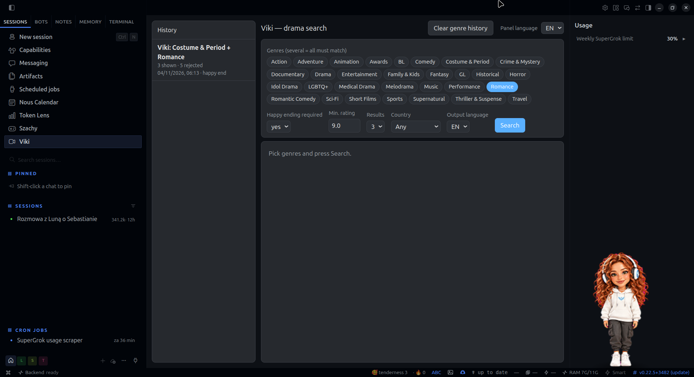
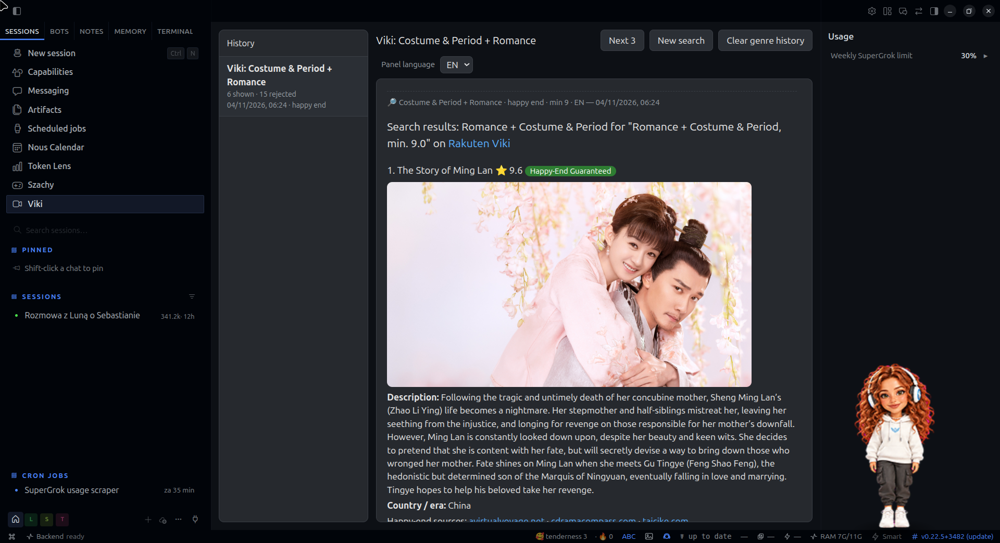

# hermes-viki

A [Hermes Agent](https://github.com/NousResearch/hermes-agent) plugin + Hermes Desktop page for finding dramas on
**Rakuten Viki**: pick genres (or combine them, e.g. *Romance + Costume & Period*), optionally require a
**verified happy ending**, and get the next best-rated titles you have not seen yet — with Viki's own images,
ratings and links, and descriptions in English, Polish, Japanese or Chinese.

> Unofficial project. Not affiliated with, endorsed by or sponsored by Rakuten Viki. Titles, descriptions and
> images are fetched from Viki's public API and belong to Rakuten Viki and the respective rights holders.

## Screenshots





## Features

- **Agent tools**: `viki_candidates`, `viki_mark`, `viki_genres`, `viki_reset`.
- **Desktop page "Viki"** (sidebar): genre chips (multi-select = intersection), happy-end yes/no, minimum rating,
  number of results (1–3), origin country filter, output language, *Next 3*, *New search*, *Clear genre history*,
  and a history list that restores earlier results.
- **One persistent chat per genre combination** (`Viki: Romance`, `Viki: Romance + Costume & Period`, …) that shows up
  in the normal Hermes chat list.
- **Per-genre memory**: shown and rejected titles are skipped next time, so *Next 3* always gives new titles.
- **Authoritative data**: title, rating, review count, 16:9 billboard image, Viki link and availability are inserted
  from the Viki API by the renderer — never written by the model.
- **Server-side happy-end verification** (see below), cached per title.
- **Economy mode**: the backend picks and verifies titles; the agent only translates descriptions in one short,
  tool-free turn. Translations are cached per title and language, so repeated results need no model call at all.
- **Panel language** EN / PL / JP / ZH (default EN) and separate **output language** EN / PL / JP / ZH for results.
- Follows the Hermes Desktop light/dark theme.

## Requirements

- Hermes Agent with plugin support and Hermes Desktop (for the panel). The agent tools also work without Desktop.
- A Hermes **web search backend** configured (`web.backend` in `config.yaml`; developed and tested with the `xai`
  backend). It is used by the happy-end checker. No extra API keys are needed by this plugin itself.
- Python 3.10+ (the one bundled with Hermes) and network access to `api.viki.io`.

## Installation

```bash
git clone <this repo> hermes-viki && cd hermes-viki

# 1. plugin (agent tools + dashboard API routes)
cp -r plugin/viki ~/.hermes/plugins/viki

# 2. enable it: add "viki" to plugins.enabled in ~/.hermes/config.yaml
#    plugins:
#      enabled:
#        - viki

# 3. Desktop page (copies ui/plugin.js to ~/.hermes/desktop-plugins/viki/plugin.js)
sh ~/.hermes/plugins/viki/ui/build.sh

# 4. optional skill for normal chat requests ("find me a romance on Viki")
mkdir -p ~/.hermes/skills/media && cp -r skills/viki-search ~/.hermes/skills/media/

# 5. restart Hermes (gateway + dashboard), then reload Hermes Desktop (Ctrl+R)
```

Check it loaded: `hermes plugins list` and `hermes tools list` should show `viki`.

## Configuration

Optional `~/.hermes/plugins/viki/data/config.json` (see `config.example.json`):

| key | default | meaning |
|---|---|---|
| `export_dir` | `""` | If set (e.g. a folder inside an Obsidian vault), every rendered result is also saved there as a `.md` file. Empty = no file export. |
| `min_reviews` | `500` | Ignore titles with fewer Viki ratings (avoids tiny-sample 10.0 scores). |
| `max_results` | `3` | Results per search (the panel allows 1–3). |
| `max_pages` | `12` | Viki listing pages fetched per genre (50 titles each). |
| `cache_ttl_s` | `86400` | Genre catalogue cache lifetime. |
| `max_new_checks` | `15` | Safety cap of new happy-end checks per search. |
| `romance_includes_romcom` | `true` | "Romance" = Viki *Romance* ∪ *Romantic Comedy*. |

The results template used by the skill is `plugin/viki/templates/viki-results.md`.

## How happy-end verification works

For each candidate (in rating order, only as many as needed):

1. One web search via the configured Hermes web backend: `"<title>" <K-drama|C-drama|…> ending explained happy or sad`.
   A second query (`… finale ending reddit mydramalist`) runs only if the first result is inconclusive.
2. Results that are not about the title are dropped. Each remaining result is classified with keyword heuristics
   (happy ending / happily ever after / end up together / … vs. sad / tragic / bittersweet / open ending / BE …).
   Questions like "happy or sad?", negations ("avoids a sad ending"), speculation, mid-season reviews and results
   that do not talk about the ending are ignored.
3. Verdict: **HAPPY** only if at least **two different domains** support a happy ending and none disagrees
   (a single dissenting site is tolerated only against ≥4 agreeing domains). Otherwise **SAD** or **UNCERTAIN**,
   and the title is skipped and remembered as rejected for that genre.
4. Verdicts and the supporting source URLs are cached per Viki id (`data/happyend/<id>.json`; 180 days, UNCERTAIN 14 days).
   The rendered result lists those exact URLs under *Happy-end sources*.

It is a heuristic: it prefers skipping a good title over promising a happy ending that is not confirmed.
Snippets returned by some search backends are summaries generated by the backend, not verbatim quotes.

## Languages

- **Panel language** (UI strings, genre and country names): EN, PL, JP, ZH — remembered, default EN.
- **Output language** (results): EN uses Viki's English description (no model call); JP/ZH use Viki's own Japanese/Chinese
  title and description when available; otherwise (and for PL) the agent translates in one short tool-free turn.
  All strings live in one dictionary per language (`LABELS` in `viki_core.py`, `MESSAGES` in `ui/plugin.js`).

## Catalogue / region note

Viki decides availability by the **IP region of the machine running Hermes**. The API reports `blocked` for the caller's
region only (no per-country data), and geo-blocked titles are typically hidden from listings. The plugin therefore
shows only titles available where you are; labels say "Available in UK" because it was developed in the UK — adjust
the `uk` label in `LABELS` if you run it elsewhere. Do not use VPNs to circumvent Viki's licensing.

## Data & privacy

Runtime data stays local in `~/.hermes/plugins/viki/data/` (genre lists, chat links, caches, verdicts, translations)
and is git-ignored. Older installs with Polish directory names / genre keys are migrated automatically on first load.

## Author & contact

Sebastian M — X: [@sebnatmal](https://x.com/sebnatmal). Bug reports, ideas and pull requests are welcome as GitHub issues.

## License

MIT — see [LICENSE](LICENSE).
